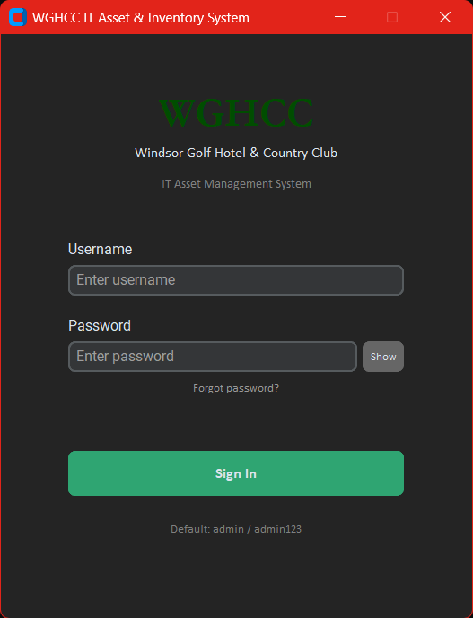
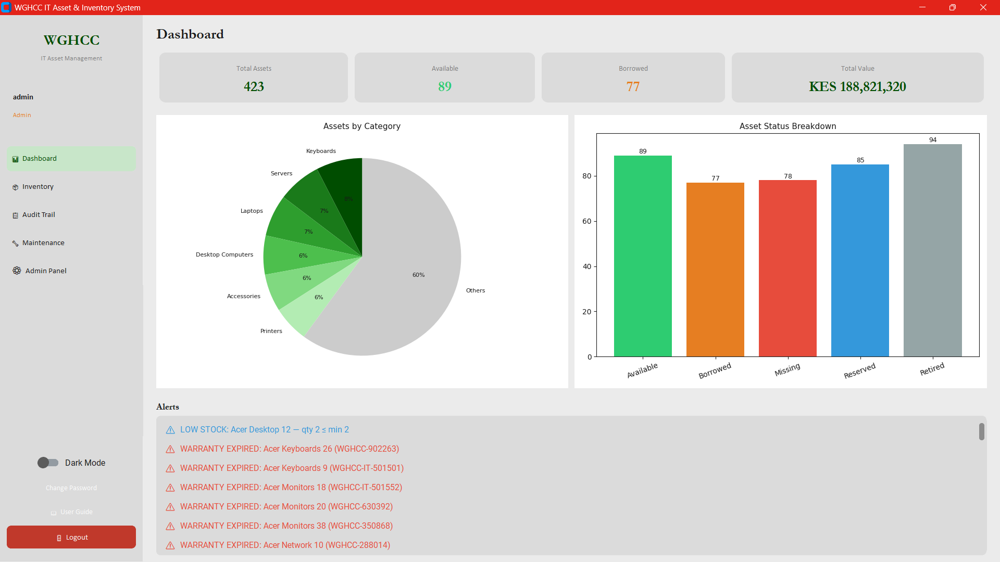
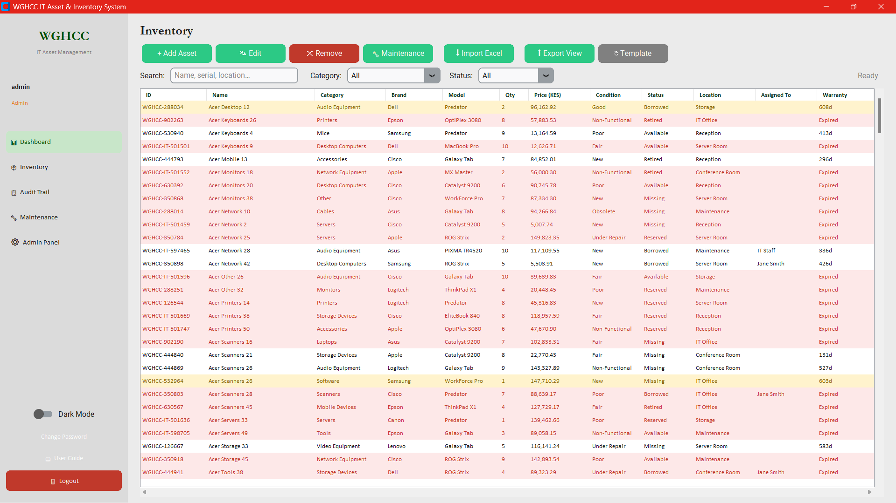
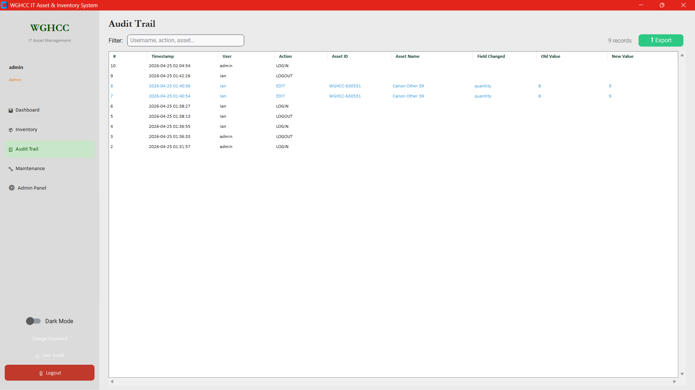
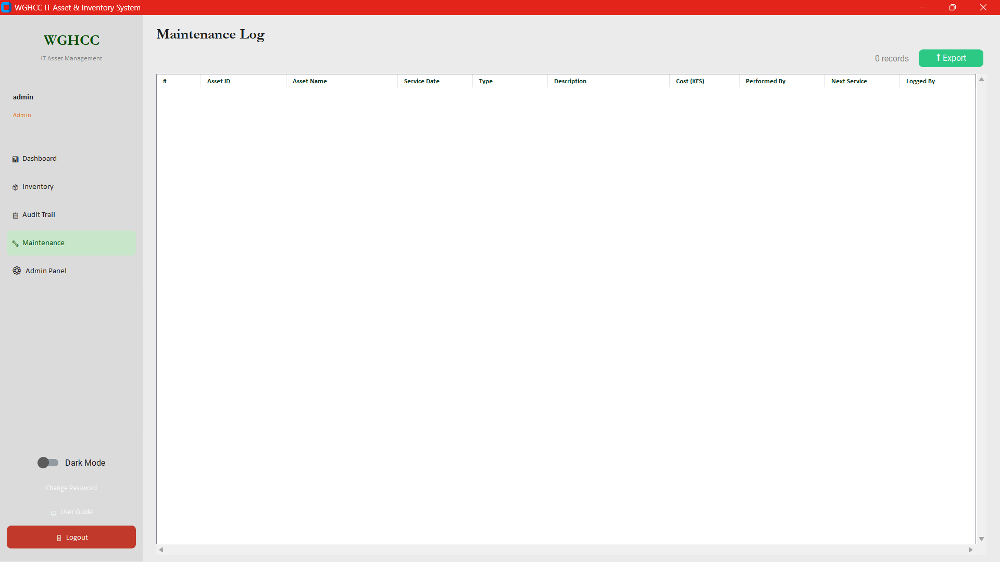
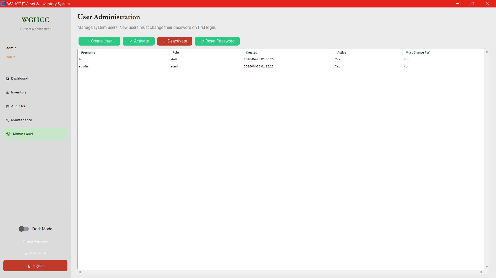
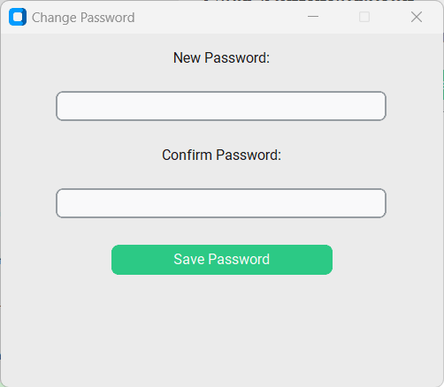
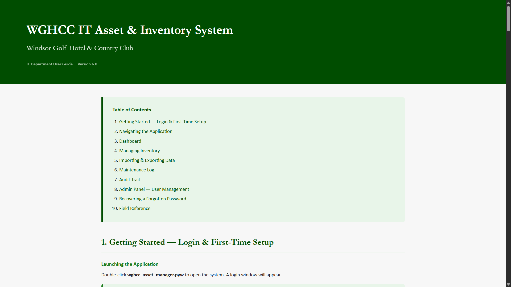

# 🖥️ WGHCC IT Asset Manager: Desktop Inventory & Audit System

**WGHCC IT Asset Manager** is a production-grade desktop application designed to bridge the gap between scattered spreadsheet-based IT tracking and a structured, auditable asset management system — purpose-built for the IT department of Windsor Golf Hotel & Country Club, Nairobi.

---

## 🎯 Project Goal

Windsor Golf Hotel & Country Club's IT department managed 400+ assets across departments with no formal tracking system — items were logged in ad-hoc spreadsheets with no change history, no access control, and no visibility into warranty status or maintenance schedules. The original attachment deliverable (May 2024) was a simple Tkinter CSV tracker. This repository is the fully rebuilt and hardened version: a 1,616-line CustomTkinter application with authenticated sessions, field-level audit logging, embedded Matplotlib analytics, and Excel import/export — demonstrating production-grade desktop software development in Python.

> **Data note:** The bundled `wghcc_inventory.db` contains 423 rows of synthetic asset data generated by a Python script. No real hotel records are included.

---

## 🧬 System Architecture

1. **Presentation Layer** — **CustomTkinter 5.2.2** provides the full desktop UI: a hidden `CTk()` root manages a `LoginWindow` and `MainApp` as persistent `CTkToplevel` children, preventing Tcl/Tk interpreter corruption on logout/re-login cycles.
2. **View Layer** — Five named views (`DashboardView`, `InventoryView`, `AuditView`, `MaintenanceView`, `AdminView`) are instantiated once and shown/hidden via a sidebar navigator. Each implements `on_show()` for lazy data loading.
3. **Cache Layer** — **`ItemCache`** holds the inventory list with a dirty flag. Views read from cache; mutations (add/edit/delete) invalidate the flag, triggering exactly one `SELECT *` on the next read regardless of how many views consume it.
4. **Persistence Layer** — **SQLite 3** via the standard `sqlite3` module. `DatabaseManager` owns all queries, handles schema migration via `PRAGMA table_info`, and exposes typed methods to each view.
5. **Analytics Layer** — **Matplotlib 3.10** renders a category bar chart and status pie chart embedded in the dashboard via `FigureCanvasTkAgg`. Figures are created once and redrawn in-place to avoid repeated canvas allocation.
6. **Data I/O Layer** — **Pandas 2.3 + openpyxl** handle bulk Excel import with column mapping validation and filtered Export-to-Excel from any view state.

---

## 🛠️ Technical Stack

| **Layer** | **Tool** | **Version** |
|---|---|---|
| **UI Framework** | CustomTkinter | 5.2.2 |
| **Database** | SQLite 3 (`sqlite3`) | stdlib |
| **Analytics** | Matplotlib (`FigureCanvasTkAgg`) | 3.10 |
| **Tables** | `ttk.Treeview` (styled) | stdlib |
| **Data I/O** | Pandas + openpyxl | 2.3 / 3.1.5 |
| **Security** | PBKDF2-HMAC-SHA256 | 100k iterations, 32-byte salt |
| **Runtime** | Python | 3.10+ |
| **Platform** | Windows 11 (tested) | — |

---

## 📊 Performance & Results

- **1,616 lines** of Python — single-file, zero external service dependencies
- **423 synthetic asset records** across 19 categories loaded from the bundled demo database
- **4 database tables:** `inventory`, `users`, `audit_log`, `maintenance_log`
- **5 application views:** Dashboard, Inventory, Audit Trail, Maintenance, Admin Panel
- **19 asset categories** — from Desktop Computers and Servers to Cables, UPS Systems, and Software licences
- **7 condition states** and **5 lifecycle statuses** per asset
- **PBKDF2-HMAC-SHA256** password hashing with per-user 32-byte random salt — no plaintext credentials stored
- **Field-level audit trail** — every individual field change records `(field, old_value, new_value)` with timestamp and actor
- **~3× faster** dashboard re-renders via figure reuse vs. recreating `FigureCanvasTkAgg` on each visit
- **Instant KPI display** — deferred chart rendering with `self.after(5, ...)` so numbers appear before canvas work begins

---

## 📸 Screenshots

### Login

*PBKDF2-hashed authentication with show/hide password toggle and recovery code flow*

### Dashboard

*Live KPI cards (total assets, low-stock alerts, warranty expiries, items under repair) with category bar chart and status pie chart*

### Inventory

*Full CRUD table — 423 assets, colour-coded by condition/warranty status, with search, category and status filters*

### Audit Trail

*Field-level change log: every edit records the exact field name, old value, and new value with actor and timestamp*

### Maintenance Log

*Per-asset maintenance events with technician, cost, scheduled date, and completion status*

### Admin Panel

*User management: create accounts, assign roles, reset passwords, deactivate users (admin role only)*

### Change Password

*Forced password change dialog on first login, with confirmation validation*

### In-App User Guide

*`user_guide.html` rendered in the default browser — covers all 10 functional areas with field reference*

---

## 📋 Asset Domain Reference

### Categories (19)

| Hardware | Peripherals | Infrastructure | Other |
|---|---|---|---|
| Desktop Computers | Keyboards | Network Equipment | Software |
| Laptops | Mice | Cables | Tools |
| Monitors | Printers | Servers | Accessories |
| Mobile Devices | Scanners | UPS Systems | Other |
| Storage Devices | Audio Equipment | Video Equipment | |

### Conditions & Lifecycle Statuses

| Condition (7) | Status (5) |
|---|---|
| New | Available |
| Good | Borrowed |
| Fair | Missing |
| Poor | Reserved |
| Obsolete | Retired |
| Non-Functional | |
| Under Repair | |

### Synthetic Demo Dataset Breakdown

| Metric | Count |
|---|---|
| Total inventory items | 423 |
| Available | 89 |
| Reserved | 85 |
| Retired | 94 |
| Borrowed | 77 |
| Missing | 78 |
| Good condition | 55 |
| Under Repair | 72 |
| Non-Functional | 60 |

---

## 🧠 Key Design Decisions

- **Single hidden CTk root:** CustomTkinter shares one Tcl/Tk interpreter per process. Destroying and recreating a `ctk.CTk()` root (e.g. on logout) corrupts interpreter state and crashes on re-login. Both `LoginWindow` and `MainApp` are `CTkToplevel` children of a hidden root that lives for the full process lifetime.

- **ItemCache with dirty flag:** Every view switch does not re-query the database. `ItemCache.get()` returns a valid list immediately; the dirty flag is set only on add/edit/delete. A full mutation cycle produces exactly one `SELECT *` regardless of how many views consume the data.

- **Figure reuse for Matplotlib:** `Figure` and `FigureCanvasTkAgg` are created once and stored as instance variables. Revisiting the dashboard calls `fig.clear()` and redraws on the existing canvas — approximately 3× faster than creating new figure objects on each visit.

- **Deferred chart rendering:** `DashboardView.on_show()` updates KPI cards and alert badges synchronously, then defers chart rendering with `self.after(5, _draw_charts)`. The view appears instantly because the numbers are visible before the heavier canvas operations complete.

- **Field-level audit trail:** The audit log records `(field_changed, old_value, new_value)` per edited field, not a coarse "item updated" event. This enables precise asset history reconstruction — useful for warranty disputes, loss investigations, and compliance audits.

- **Forward-compatible schema migration:** On startup, `DatabaseManager._migrate()` reads `PRAGMA table_info(audit_log)`. If an older two-column schema is detected, the table is rebuilt to the current schema while preserving all inventory and user data.

---

## 📂 Project Structure

```text
wghcc-asset-manager/
├── wghcc_asset_manager.py   # Main application — 1,616 lines, 121 classes/methods
├── wghcc_inventory.db       # Synthetic demo dataset — 423 assets, 4 tables
├── sample_data.xlsx         # Excel import template with demo rows
├── user_guide.html          # In-app HTML user guide (opens from sidebar)
├── requirements.txt
├── assets/
│   ├── login.png
│   ├── dashboard.png
│   ├── inventory.png
│   ├── audit.png
│   ├── maintenance.png
│   ├── admin.png
│   ├── change_password.png
│   └── user_guide.png
└── .gitignore
```

---

## ⚙️ Installation & Setup

**Requirements:** Python 3.10+, Windows / macOS / Linux (tested on Windows 11)

```bash
git clone https://github.com/declerke/WGHCC-Asset-Manager.git
cd WGHCC-Asset-Manager

python -m venv .venv

# Windows
.venv\Scripts\activate
# macOS / Linux
source .venv/bin/activate

pip install -r requirements.txt
```

**Run:**

```bash
# Windows (no console window)
pythonw wghcc_asset_manager.py

# macOS / Linux
python wghcc_asset_manager.py
```

**Service URLs / Credentials:**

| Item | Value |
|---|---|
| Default username | `admin` |
| Default password | `admin123` |
| Recovery code | `WGHCC-IT-RESET` |

> You will be prompted to set a new password on first login. The demo database (`wghcc_inventory.db`) is bundled — the app loads with 423 synthetic assets immediately after login.

**To start with a blank database:** delete `wghcc_inventory.db` before launching. Use **Inventory → Import Excel** to load `sample_data.xlsx`.

---

## 🗄️ Database Schema

```sql
inventory (
    item_id TEXT PRIMARY KEY,
    name TEXT, category TEXT, quantity INTEGER,
    condition TEXT, status TEXT, brand TEXT, model TEXT,
    serial_number TEXT, purchase_date TEXT, purchase_price REAL,
    warranty_expiry TEXT, supplier TEXT, location TEXT,
    assigned_to TEXT, minimum_stock INTEGER, specifications TEXT,
    notes TEXT, created_at TEXT, updated_at TEXT, created_by TEXT
)

users (
    user_id TEXT PRIMARY KEY,
    username TEXT UNIQUE, password_hash TEXT, salt TEXT,
    role TEXT, created_at TEXT, created_by TEXT,
    is_active INTEGER, must_change_password INTEGER
)

audit_log (
    log_id TEXT PRIMARY KEY,
    timestamp TEXT, username TEXT, action TEXT,
    item_id TEXT, field_changed TEXT,
    old_value TEXT, new_value TEXT
)

maintenance_log (
    log_id TEXT PRIMARY KEY,
    item_id TEXT, scheduled_date TEXT, completed_date TEXT,
    technician TEXT, description TEXT, cost REAL,
    status TEXT, created_by TEXT, created_at TEXT
)
```

---

## 🎓 Skills Demonstrated

- **Python desktop GUI development** — CustomTkinter, `ttk.Treeview`, multi-window lifecycle management with a single persistent Tk root
- **SQLite & SQL** — 4-table normalised schema, PRAGMA-based schema migration, parameterised queries, WAL-safe writes
- **Embedded data visualisation** — Matplotlib bar and pie charts rendered inside a Tkinter canvas via `FigureCanvasTkAgg`; figure reuse pattern for performance
- **Application security** — PBKDF2-HMAC-SHA256 password hashing, per-user random salt, role-based view access, forced password change on first login, recovery code flow
- **Audit & compliance patterns** — Field-level immutable change log; every mutation is traceable to a user, timestamp, and exact value delta
- **Data engineering patterns** — Bulk Excel ingestion with column validation, dirty-flag cache layer, typed dataclass models
- **Software architecture** — MVC-style separation of concerns, lazy view initialisation, deferred rendering, single-query-per-cycle cache invalidation

---

## 🏨 Background

This project originated as a final-year IT attachment deliverable for Windsor Golf Hotel & Country Club, Nairobi, Kenya (May 2024). The hotel's IT department tracked 400+ assets across departments using ad-hoc spreadsheets — no access control, no change history, no warranty visibility. The attachment deliverable was a basic Tkinter CSV tracker. This repository is the rebuilt and hardened version, developed after the attachment period to demonstrate production-grade desktop application development.
